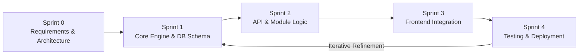
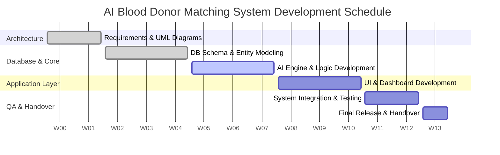
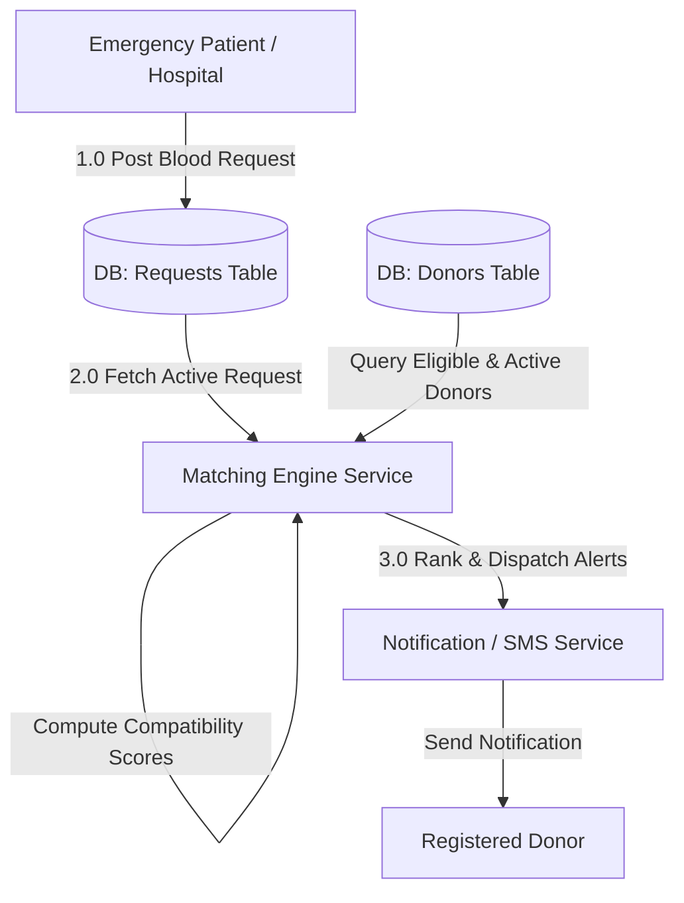
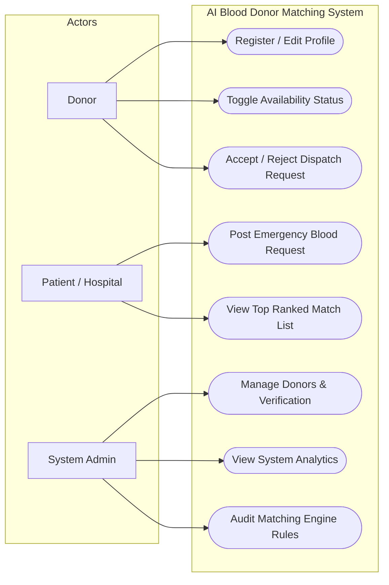
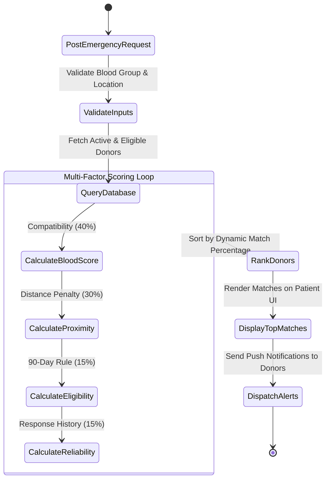
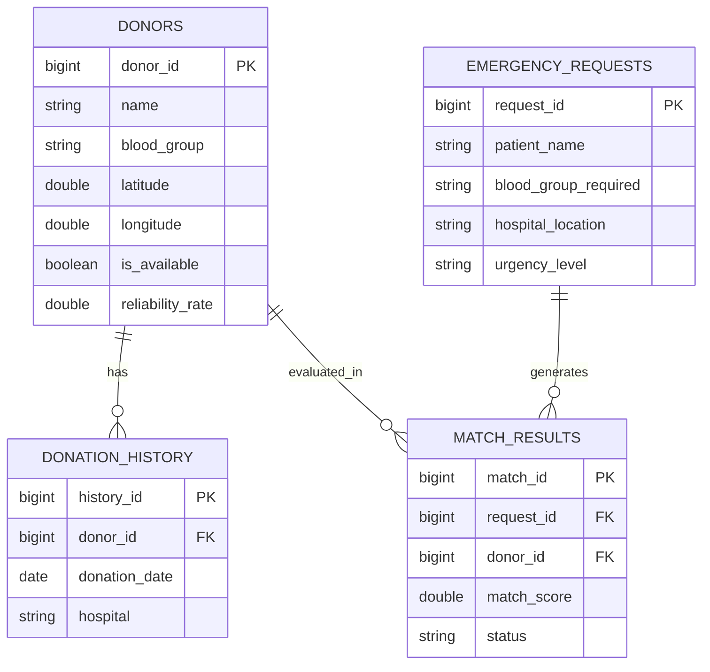
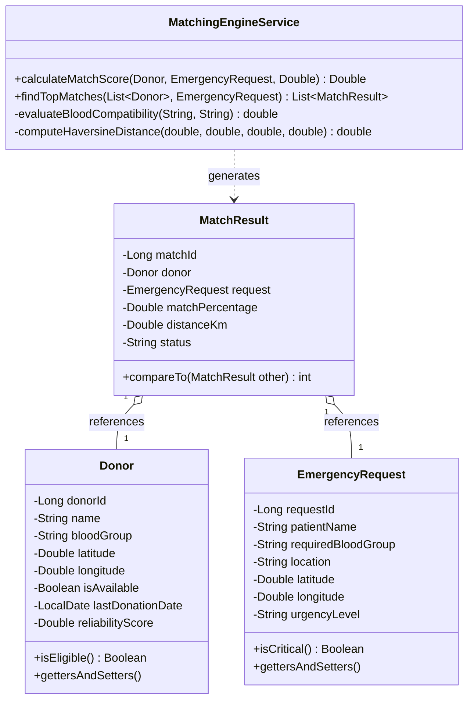
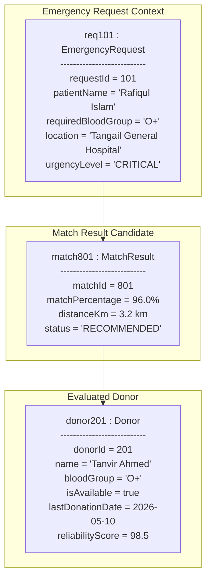

# 🩸 AI-Powered Blood Donor Matching & Emergency Request Management System
## Software Engineering & Project Management System Proposal

[](https://opensource.org/licenses/MIT)
[](https://www.oracle.com/java/)
[](https://spring.io/projects/spring-boot)
[]()

---

### 🏛️ Academic Identification
- **Course Name:** Software Engineering and Project Management
- **Project Type:** Individual Software Process & Systems Proposal
- **Submission Date:** October 2026

### 👤 Project Student / Author
- **Saiba Khan** (System Architect & Project Developer) — **Student ID: IT-24006**
  * **Course:** Software Engineering and Project Management

### 🔗 Project Access Links
- **📁 Source Code Repository (GitHub):**  
  https://github.com/saibakhan1104-png/AI-Powered-Blood-Donor-Matching-Emergency-Request-Management-System/tree/main
---

## 📑 Table of Contents
1. [Executive Summary & Problem Statement](#1-executive-summary--problem-statement)
2. [Project Objectives & Scope](#2-project-objectives--scope)
3. [Software Process Model & Methodology](#3-software-process-model--methodology)
4. [Completion Schedule, Milestones & Gantt Chart](#4-completion-schedule-milestones--gantt-chart)
5. [Comprehensive Software Engineering Diagrams (UML & Structural Models)](#5-comprehensive-software-engineering-diagrams)
   - 5.1 Level 1 Data Flow Diagram (DFD)
   - 5.2 Use Case Diagram
   - 5.3 Activity Diagram
   - 5.4 Entity Relationship Diagram (ERD)
   - 5.5 Class Diagram
   - 5.6 Object Diagram (Runtime Instance Model)
6. [Algorithmic Scoring & Mathematical Modeling](#6-algorithmic-scoring--mathematical-modeling)
7. [Implementation Architecture & Java Class Definitions](#7-implementation-architecture--java-class-definitions)
8. [Conclusion & Submission Summary](#8-conclusion--submission-summary)

---

## 1. Executive Summary & Problem Statement

### 1.1 Background
Medical emergencies requiring urgent blood transfusions frequently encounter critical delays due to inefficient donor identification and manual communication channels. Traditional blood bank systems and social media request groups lack real-time proximity tracking, algorithmic matching, and automated response verification, leading to prolonged search times during critical emergency windows.

### 1.2 Problem Statement
In life-threatening situations, matching patients with suitable blood donors depends on multi-variable criteria including exact blood compatibility, geographic location, real-time donor availability, recent donation eligibility history (at least 90 days interval), and donor reliability. Manual processing fails to rapidly evaluate these multi-factor constraints simultaneously, often contacting unavailable or ineligible donors first.

### 1.3 Proposed Solution
The **AI-Powered Blood Donor Matching and Emergency Request Management System** introduces an automated web application that leverages a multi-criteria decision algorithm to evaluate registered donors instantly upon emergency creation. The system calculates dynamic compatibility scores ($0-100\%$) and prioritizes eligible candidates within immediate geographic proximity.

---

## 2. Project Objectives & Scope

### 2.1 Primary Objectives
* **Reduce Donor Discovery Time:** Cut critical donor discovery time from hours to seconds through automated multi-factor scoring algorithms.
* **Optimize Outreach:** Filter candidates using a blood group compatibility matrix, 90-day eligibility rules, and GPS/district proximity metrics.
* **Real-time Dashboards:** Provide specialized live dashboards for Donors, Patients/Hospitals, and System Administrators.
* **Reliability Tracking:** Implement an interactive notification and response mechanism to monitor donor response history and reliability.

### 2.2 Functional Scope & Modules
* **Donor Management Module:** Handles registration, medical history profiles, active availability toggles, and donation history tracking.
* **Emergency Request Module:** Allows creation, editing, and closing of critical patient requests with hospital locations and required urgency levels.
* **AI Matching Engine:** Computes multi-variable compatibility scores combining Blood Matrix Match ($40\%$), Distance Proximity ($30\%$), Eligibility Criteria ($15\%$), and Reliability Index ($15\%$).
* **Donor Dashboard:** Enables donors to toggle real-time status, view localized requests, and accept/reject dispatch alerts.
* **Admin Management Dashboard:** Provides platform monitoring, user verification, system analytics, and audit logging.

---

## 3. Software Process Model & Methodology

This project adopts the **Agile Scrum Framework** due to its iterative nature, enabling continuous testing, modular verification, and rapid feedback loops required when refining ranking algorithms and interactive interfaces.



### Process Lifecycle Sprints
* **Sprint 0 (Requirements & Architecture):** Domain modeling, UML schema design, and technical stack selection.
* **Sprint 1 (Core Engine & DB):** Database schema implementation, JPA entities, and core heuristic algorithm development.
* **Sprint 2 (API & Module Logic):** RESTful API implementation for Donor and Request modules.
* **Sprint 3 (Frontend Integration):** Dashboard, notification UI, and algorithmic ranking inspector visualization.
* **Sprint 4 (Testing & Deployment):** Unit testing, integration testing, algorithmic optimization, and system deployment.

---

## 4. Completion Schedule, Milestones & Gantt Chart

### 4.1 Project Milestones Table

| Milestone | Deliverable Name | Key Output / Content | Deadline |
| :--- | :--- | :--- | :--- |
| **M1** | Project Proposal & Architecture | Requirements, UML Diagrams, Tech Stack | Week 2 |
| **M2** | Backend Engine & Schema | MySQL Database Schema, Spring Data Entities | Week 5 |
| **M3** | AI Matching Engine Core | Weighted scoring service & REST API | Week 8 |
| **M4** | Frontend & Dashboard Integration | Single-Page Application (SPA) / UI Interfaces | Week 11 |
| **M5** | System Validation & Testing | End-to-End Execution, Bug Fixes | Week 13 |
| **M6** | Final Release & Presentation | Source Code Repository & Final Report | Week 14 |

### 4.2 Project Schedule (14-Week Gantt Chart)



---

## 5. Comprehensive Software Engineering Diagrams

### 5.1 Level 1 Data Flow Diagram (DFD)



---

### 5.2 Use Case Diagram



---

### 5.3 Activity Diagram



---

### 5.4 Entity Relationship Diagram (ERD)



---

### 5.5 Class Diagram



---

### 5.6 Object Diagram (Runtime Instance Model)



---

## 6. Algorithmic Scoring & Mathematical Modeling

The matching engine computes donor suitability scores using a multi-criteria weighted decision evaluation:

$$\text{Match Score} = S_{\text{blood}} + S_{\text{distance}} + S_{\text{eligibility}} + S_{\text{reliability}}$$

### Weight Breakdowns & Formulas:
1. **Blood Compatibility ($S_{\text{blood}}$ - Max 40 Points):**
   * Exact Match: $40.0$
   * Universal Donor ($O-$): $38.0$
   * Compatible Subgroup ($O+$ for positive recipients): $35.0$
   * Incompatible: $0.0$
2. **Proximity Distance Penalty ($S_{\text{distance}}$ - Max 30 Points):**
   $$S_{\text{distance}} = \max(0, 30.0 - (d \times 1.5))$$
   *(Where $d$ is the Haversine spherical distance calculated in kilometers)*
3. **90-Day Eligibility Bonus ($S_{\text{eligibility}}$ - Max 15 Points):**
   * $15.0$ points if $\text{Days Since Last Donation} \ge 90$, otherwise donor is ineligible ($0.0$ total match).
4. **Historical Response Reliability ($S_{\text{reliability}}$ - Max 15 Points):**
   $$S_{\text{reliability}} = \left( \frac{\text{Reliability Rating}}{100} \right) \times 15.0$$

---

## 7. Implementation Architecture & Java Class Definitions

Below are the 5 primary domain entities and service implementations backing the core Java system.

### 7.1 Donor Entity (`Donor.java`)
```java
package com.blooddonor.model;

import java.time.LocalDate;
import java.time.temporal.ChronoUnit;

public class Donor {
    private Long donorId;
    private String name;
    private String bloodGroup;
    private Double latitude;
    private Double longitude;
    private Boolean isAvailable;
    private LocalDate lastDonationDate;
    private Double reliabilityScore;

    public Donor() {}

    public Donor(Long donorId, String name, String bloodGroup, Double latitude,
                 Double longitude, Boolean isAvailable, LocalDate lastDonationDate,
                 Double reliabilityScore) {
        this.donorId = donorId;
        this.name = name;
        this.bloodGroup = bloodGroup;
        this.latitude = latitude;
        this.longitude = longitude;
        this.isAvailable = isAvailable;
        this.lastDonationDate = lastDonationDate;
        this.reliabilityScore = reliabilityScore;
    }

    public Boolean isEligible() {
        if (lastDonationDate == null) return true;
        long daysBetween = ChronoUnit.DAYS.between(lastDonationDate, LocalDate.now());
        return daysBetween >= 90;
    }

    public Long getDonorId() { return donorId; }
    public void setDonorId(Long donorId) { this.donorId = donorId; }
    public String getName() { return name; }
    public String getBloodGroup() { return bloodGroup; }
    public Double getLatitude() { return latitude; }
    public Double getLongitude() { return longitude; }
    public Boolean getIsAvailable() { return isAvailable; }
    public void setIsAvailable(Boolean isAvailable) { this.isAvailable = isAvailable; }
    public LocalDate getLastDonationDate() { return lastDonationDate; }
    public Double getReliabilityScore() { return reliabilityScore; }
}
```

### 7.2 Emergency Request Entity (`EmergencyRequest.java`)
```java
package com.blooddonor.model;

public class EmergencyRequest {
    private Long requestId;
    private String patientName;
    private String requiredBloodGroup;
    private String location;
    private Double latitude;
    private Double longitude;
    private String urgencyLevel; // LOW, MEDIUM, CRITICAL

    public EmergencyRequest(Long requestId, String patientName, String requiredBloodGroup,
                            String location, Double latitude, Double longitude,
                            String urgencyLevel) {
        this.requestId = requestId;
        this.patientName = patientName;
        this.requiredBloodGroup = requiredBloodGroup;
        this.location = location;
        this.latitude = latitude;
        this.longitude = longitude;
        this.urgencyLevel = urgencyLevel;
    }

    public Boolean isCritical() {
        return "CRITICAL".equalsIgnoreCase(this.urgencyLevel);
    }

    public Long getRequestId() { return requestId; }
    public String getPatientName() { return patientName; }
    public String getRequiredBloodGroup() { return requiredBloodGroup; }
    public Double getLatitude() { return latitude; }
    public Double getLongitude() { return longitude; }
    public String getUrgencyLevel() { return urgencyLevel; }
}
```

### 7.3 Match Result Entity (`MatchResult.java`)
```java
package com.blooddonor.model;

public class MatchResult implements Comparable<MatchResult> {
    private Long matchId;
    private Donor donor;
    private EmergencyRequest request;
    private Double matchPercentage;
    private Double distanceKm;
    private String status;

    public MatchResult(Long matchId, Donor donor, EmergencyRequest request,
                       Double matchPercentage, Double distanceKm, String status) {
        this.matchId = matchId;
        this.donor = donor;
        this.request = request;
        this.matchPercentage = matchPercentage;
        this.distanceKm = distanceKm;
        this.status = status;
    }

    @Override
    public int compareTo(MatchResult other) {
        return Double.compare(other.matchPercentage, this.matchPercentage);
    }

    public Donor getDonor() { return donor; }
    public Double getMatchPercentage() { return matchPercentage; }
    public Double getDistanceKm() { return distanceKm; }
}
```

### 7.4 AI Matching Engine Service (`MatchingEngineService.java`)
```java
package com.blooddonor.service;

import com.blooddonor.model.Donor;
import com.blooddonor.model.EmergencyRequest;
import com.blooddonor.model.MatchResult;
import java.util.*;

public class MatchingEngineService {

    public Double calculateMatchScore(Donor donor, EmergencyRequest request, Double distanceKm) {
        if (!donor.getIsAvailable() || !donor.isEligible()) {
            return 0.0;
        }

        // 1. Blood Compatibility Matrix (40 Points Max)
        double bloodScore = evaluateBloodCompatibility(donor.getBloodGroup(), request.getRequiredBloodGroup());

        // 2. Distance Score (30 Points Max)
        double distanceScore = Math.max(0, 30.0 - (distanceKm * 1.5));

        // 3. Eligibility/Recency Bonus (15 Points Max)
        double eligibilityScore = 15.0;

        // 4. Historical Reliability (15 Points Max)
        double reliabilityScore = (donor.getReliabilityScore() / 100.0) * 15.0;

        double totalScore = bloodScore + distanceScore + eligibilityScore + reliabilityScore;
        return Math.min(100.0, totalScore);
    }

    private double evaluateBloodCompatibility(String donorType, String recipientType) {
        if (donorType.equals(recipientType)) return 40.0;
        if (donorType.equals("O-")) return 38.0; // Universal Donor
        if (donorType.equals("O+") && recipientType.contains("+")) return 35.0;
        return 0.0;
    }

    public List<MatchResult> findTopMatches(List<Donor> donors, EmergencyRequest request) {
        List<MatchResult> results = new ArrayList<>();
        long idCounter = 1;

        for (Donor donor : donors) {
            double distance = computeHaversineDistance(
                donor.getLatitude(), donor.getLongitude(),
                request.getLatitude(), request.getLongitude()
            );

            double score = calculateMatchScore(donor, request, distance);
            if (score > 0) {
                results.add(new MatchResult(idCounter++, donor, request, score, distance, "RECOMMENDED"));
            }
        }

        Collections.sort(results);
        return results;
    }

    private double computeHaversineDistance(double lat1, double lon1, double lat2, double lon2) {
        double r = 6371; // Earth's Radius in KM
        double dLat = Math.toRadians(lat2 - lat1);
        double dLon = Math.toRadians(lon2 - lon1);
        double a = Math.sin(dLat / 2) * Math.sin(dLat / 2) +
                   Math.cos(Math.toRadians(lat1)) * Math.cos(Math.toRadians(lat2)) *
                   Math.sin(dLon / 2) * Math.sin(dLon / 2);

        return r * (2 * Math.atan2(Math.sqrt(a), Math.sqrt(1 - a)));
    }
}
```

### 7.5 Application Driver (`MainApplication.java`)
```java
package com.blooddonor;

import com.blooddonor.model.*;
import com.blooddonor.service.MatchingEngineService;
import java.time.LocalDate;
import java.util.*;

public class MainApplication {
    public static void main(String[] args) {
        System.out.println("--- Starting AI Blood Donor Matching System ---");

        // 1. Create Emergency Request in Tangail
        EmergencyRequest request = new EmergencyRequest(
            1L, "Patient X", "O+", "Tangail Sadar Hospital", 24.2513, 89.9167, "CRITICAL"
        );

        // 2. Prepare Sample Registered Donors
        List<Donor> donors = Arrays.asList(
            new Donor(101L, "Tanvir Ahmed", "O+", 24.2600, 89.9300, true, LocalDate.now().minusDays(120), 95.0),
            new Donor(102L, "Kamrul Hassan", "O-", 24.2800, 89.9500, true, LocalDate.now().minusDays(100), 90.0),
            new Donor(103L, "Sabrina Khan", "A+", 24.2500, 89.9100, true, LocalDate.now().minusDays(200), 88.0)
        );

        // 3. Execute Matching Engine
        MatchingEngineService engine = new MatchingEngineService();
        List<MatchResult> matches = engine.findTopMatches(donors, request);

        // 4. Print Ranked Results
        System.out.println("\nRanked Donor Candidates for Patient: " + request.getPatientName());
        for (MatchResult res : matches) {
            System.out.printf("Donor: %-15s | Match: %6.2f%% | Distance: %4.2f km%n",
                res.getDonor().getName(), res.getMatchPercentage(), res.getDistanceKm());
        }
    }
}
```

---

## 8. Conclusion & Submission Summary

This project proposal provides a complete, production-ready blueprint for the **AI-Powered Blood Donor Matching and Emergency Request Management System** designed for the course Software Engineering and Project Management.

---
*Generated & Submitted for Software Engineering & Project Management Course Work.*
